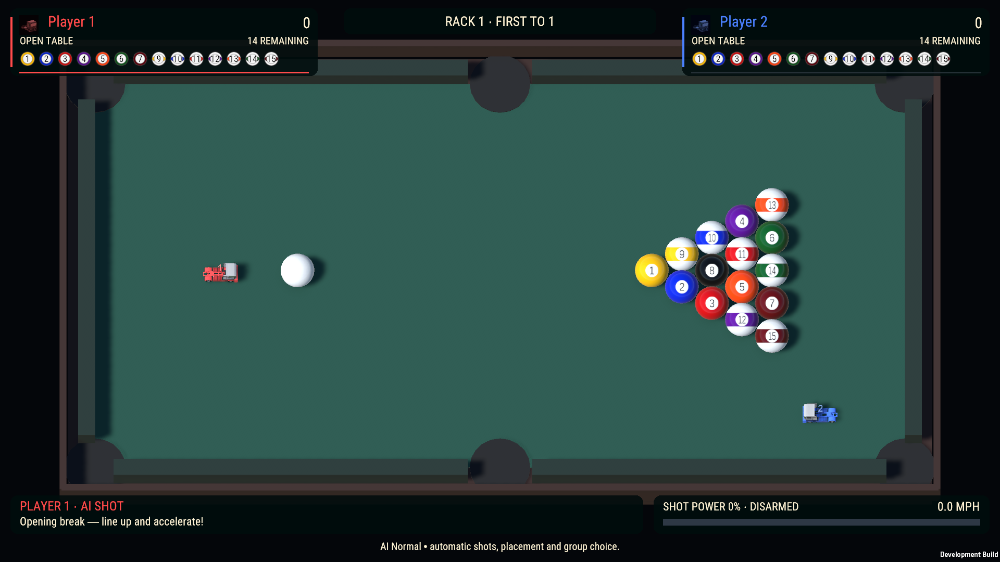

# Billiards — graphical gameplay HUD

HPR-12 requests a full polished HUD pass while preserving the table, gameplay and physics. The previous presentation consisted of player/group numbers and several text strips. The existing match/session/rules remain authoritative; `BilliardsHUD` now delegates its existing 10 Hz refresh to an optional saved `BilliardsHudPresentation` adapter.

## Changes

- Two compact participant cards with global names, identity colors, truck portraits and rack wins.
- Graphical numbered ball objectives with solid/stripe colors, dimmed pocketed balls, actual remaining counts and a dedicated eight-ball objective when a group is cleared.
- Compact series/rack progress and current turn/outcome cards.
- The installed Heat `ProgressBar` displays the existing shot-power value, with ready/disarmed state and speed in MPH.
- Actual participant-specific input bindings remain visible. Practice shows one card and all fifteen object balls.
- DOTween animates the active-turn marker without moving the arena or changing input state.
- Existing setup, pause, handoff, disconnect and result pages keep their drawing/input priority. Gameplay cards hide outside the existing Match screen.

The explicit menu command is **Truck Sports → Billiards → Upgrade saved gameplay HUD**. It adds a saved UI child hierarchy; normal builds and Play Mode do not rebuild it. Existing original HUD objects and references remain intact but hidden. Repeating the explicit command preserves the authored scene bytes. Designers can edit the saved cards under **Truck Billiards HUD → Billiards broadcast HUD**.

## Preservation

All 1,782 original scene documents are retained; 627 UI documents are added. Reviewed original changes are restricted to legacy HUD visibility, the new presenter reference and Canvas child references. Unity additionally serializes the already-existing default `broadcastFraming = null` camera field; every previous camera value is unchanged. There are no table, truck, physical material, ball, rules, input or menu replacements.

## Validation

- Native EditMode: **1 passed, 0 failed**, checking independent references, objective graphics, actual Heat fill sprite, retained original HUD references and absence of physical/camera components in the UI.
- Native PlayMode: **1 passed, 0 failed**, checking the existing session's start/pause/resume/rematch ownership and read-only refresh behavior.
- Existing Billiards rule fixtures: **50 assertions passed**, preserving assignment, mixed-group choices, scratches, eight-ball outcomes and reset rules.
- Exact Windows candidate `f4a39ad0`: **18 passed, 0 failed**. All cards remain inside 720p, 1080p, ultrawide and 4:3 viewports. Legal group assignment, dimmed pocketed balls, eight-ball objective, practice, Heat fill, pause/resume and scene cleanup pass. An ordinary physical AI rack finishes after eight truck strikes and eight resolutions, followed by a successful fresh series.

The starting-rack image is paused for layout inspection. The eight-ball screenshot is an explicitly initialized rules/UI fixture. The separate result image records the completed ordinary physical AI rack. Portable receipts are in `Evidence/2026-10-22-Billiards-HUD/acceptance.json`.

One editor-authoring variable-name compilation error was corrected; its failed log is retained. A build invocation with a nonexistent method was rejected before building; the established focused build entry point is used. Neither is hidden as a successful validation result.

Human playtesting, physical controllers and listening checks remain unperformed.

## Vendor accounting

- **VENDOR ASSETS AUDITED:** existing Heat progress-bar APIs and HUD fonts, shared Truck Sports theme/portrait/rounded plates, DOTween presentation APIs, saved Billiards HUD/session/input/rules and existing rule fixtures.
- **VENDOR ASSETS USED:** `Michsky.UI.Heat.ProgressBar`, Heat-derived broadcast TMP fonts, existing truck portrait, Unity uGUI image/text/Canvas components and built-in round UI sprites, existing shared rounded plates, DOTween turn-marker animation.
- **RELEVANT ASSETS NOT USED:** no new menu framework or generated logo art is needed for this gameplay-HUD request. The existing table camera and game menus are preserved.
- **CUSTOM SYSTEMS CREATED:** a read-only Billiards HUD adapter, explicit additive scene-authoring tool and focused verification probes/tests. No competing scoring, input, camera or UI framework.
- **VENDOR SOURCE MODIFIED:** NO.
- **DUPLICATE VENDOR FUNCTIONALITY CREATED:** NO.

## Delivery

Included in the combined Windows x64 executable `Builds/TruckSports/TruckSports.exe`, full payload SHA-256 `f4a39ad0f4313e1e8525feebd65d321c0f857bcfc61009af3c8b0c69de18888a`. All 60 configured scenes remain included; previous accepted build and exact source inputs are retained. This does not declare the remaining HPR/GBC work complete.
