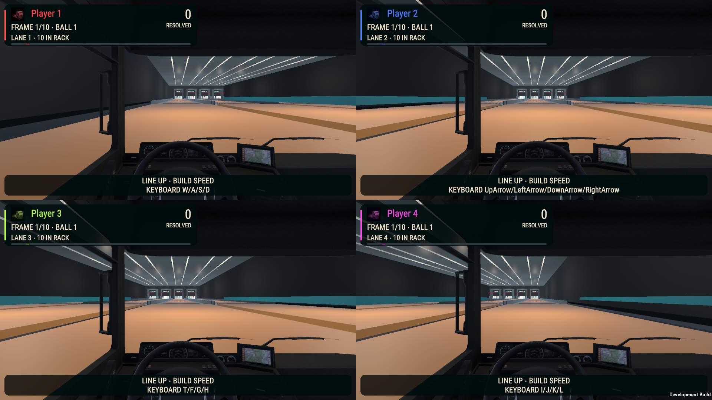
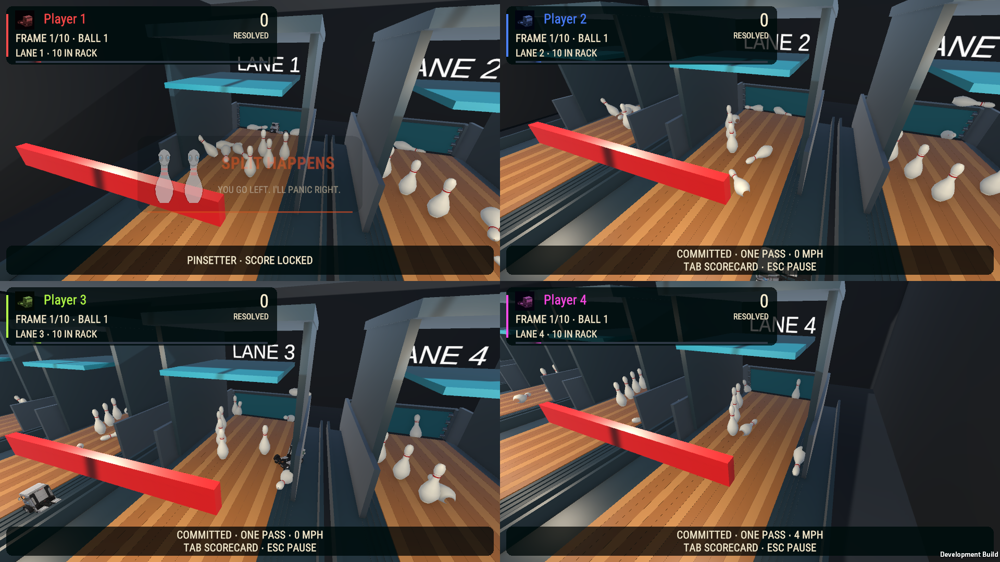

# Bowling — preserve the alley, modernize the HUD

HPR-11 explicitly approves the current gameplay and environment. This pass changes only gameplay UI. The lane, truck, pins, physics materials, gutters, back wall, pinsetter, cameras and scoring rules remain unchanged.

The old full-width name/frame text strips become compact rounded participant cards. Each contains the assigned truck portrait and color, player name, resolved total, current frame/delivery, lane/rack count and an installed Heat frame-progress bar. The resolved-total label preserves the distinction between settled totals and pending strike/spare bonuses. Small DOTween score feedback respects the existing reduced-motion option.

The existing footer and delivery-result UI are retained and restyled. Driving speed displays MPH; menu prompts follow keyboard versus controller ownership. Existing replay controls, comedic pin celebrations, result timing and pinsetter information remain under their original authorities. No menu action or input binding changes.

`BowlingMenus` remains the sole refresh/lifecycle authority and delegates to `BowlingHudPresentation` when assigned. The existing fallback HUD remains available. The explicit **Truck Sports → Bowling → Upgrade saved HUD only** command edits the saved UI hierarchy. Repeating it preserves the scene bytes. Normal builds and Play Mode never rebuild the HUD.

## Preservation

All 6,058 original scene documents remain; 145 UI documents are added. The 46 modified original documents belong only to the existing Canvas/menu reference and lane header, guidance or delivery-result UI. All four world-space lane-number signs remain unchanged. No obsolete world debug/placeholder label was found in this scene audit; legitimate lane signage is preserved.

## Validation

- Native EditMode: **1 passed, 0 failed**, checking four independent lane cards, retained references and actual Heat fill/portrait sprites.
- Native PlayMode: **1 passed, 0 failed**, checking lane ownership, pause/resume and clean rematch values.
- Existing Bowling fixtures: **32 assertions passed**, including strike/spare/tenth-frame scoring, mixed games and established control rules.
- Exact Windows candidate `56b740d8`: **67 passed, 0 failed**. Twenty software-input layout configurations cover zero through four humans and AI cameras OFF/ON at 720p/1080p. Actual cards remain within their assigned viewports and display their current lane owner. A complete four-AI ten-frame physical match finishes with scores **99/114/136/95** over **20/19/21/20** deliveries. Results, fresh zero-score rematch, pause and menu cleanup pass.

The layout image pauses software-assigned participants for viewport inspection. The pinfall image is actual AI play with an original celebration mid-fade. The results screenshot in local logs catches the beginning of the existing page fade; it is not used as evidence of settled-menu readability. Portable receipts are in `Evidence/2026-10-22-Bowling-HUD/acceptance.json`.

Human playtesting, physical controllers and listening checks remain unperformed.

## Vendor accounting

- **VENDOR ASSETS AUDITED:** installed Heat ProgressBar/font assets, DOTween, existing broadcast theme/portrait/rounded plates, saved Bowling lane UI and existing scoring/input fixtures.
- **VENDOR ASSETS USED:** `Michsky.UI.Heat.ProgressBar`, existing Heat-derived TMP font and truck portrait, Unity uGUI/TMP, existing rounded broadcast plate and DOTween score feedback. Existing NWH/camera/replay/environment systems are retained.
- **RELEVANT ASSETS NOT USED:** replacement alley art, camera and physics systems are outside the explicitly authorized UI scope. No new image generation is required.
- **CUSTOM SYSTEMS CREATED:** small read-only lane-HUD adapter, explicit saved-UI authoring and focused verification. No parallel score, input, physics or UI framework.
- **VENDOR SOURCE MODIFIED:** NO.
- **DUPLICATE VENDOR FUNCTIONALITY CREATED:** NO.

## Delivery

Combined Windows x64 executable: `Builds/TruckSports/TruckSports.exe`, all 60 configured scenes, 545 files. Full payload SHA-256: `56b740d8ea122b89455e23acc9493592233251b6c29a007343f0314c8b55b1dc`; managed assembly SHA-256: `9d810dfae17fa8190639b0bcbec95d0c49c06375ad66bc60e1c3365024f58414`. Exact 190 owned source inputs and the prior accepted build are retained. Other active HPR/GBC repairs remain unfinished.
