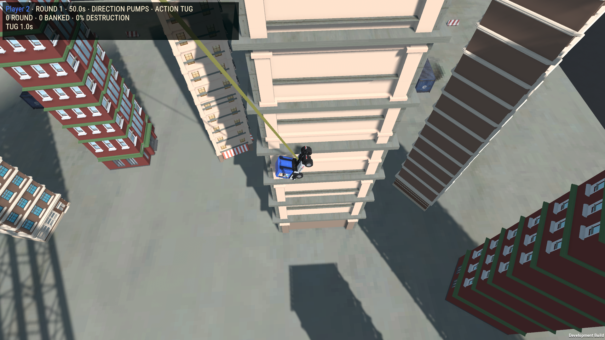
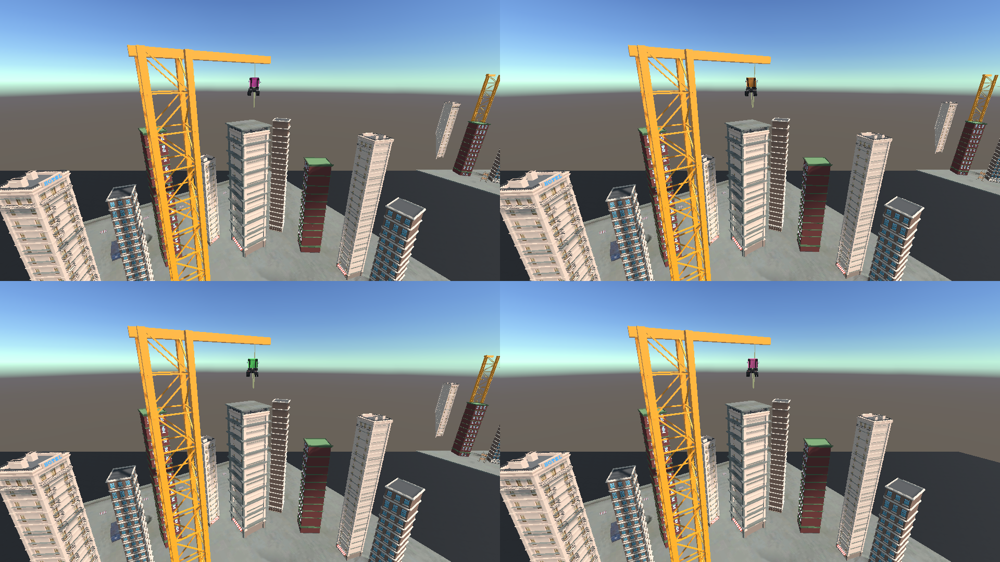

# Bungee Destruction — owned city buildings and physical impact response

Implemented HPR-BUNGEE in the existing scene. The main tower now uses owned hotel facade geometry;ten surrounding buildings use JC_LP_MegaCity House_06_V1,Hotel_01 and House_04_V1. Natural-height middle storeys repeat between unique entries/roofs. Core-Collapse EzySlice pre-cuts the actual geometry offline;matching textured pieces fall at runtime through the existing vendor prefab/support system.

## Root cause and correction

Static structural collisions consumed the impact,then replacement debris spawned with zero incoming momentum and stayed stacked on lower storeys. Before correction,actual rubble travelled0.101m over1second. The existing LWS adapters now hand off a bounded share of real contact momentum:35percent incoming velocity,capped12m/s,12m local radius,shared impulse limited to half source momentum and150N-s,with a bounded torque lever arm. Support-only/countdown/finale releases receive no artificial blast. After correction,the actual contact fixture moved16.425m and fell under gravity over3seconds. Damage thresholds,HP,score budgets,once-only scoring and support links remain unchanged.

Existing pump/reel inputs were already evaluated on the physics timestep. They were preserved and measured:2.75m/s response in the test interval,clean reversal and45.5m reel length. No speculative steering or swing-force retune was applied.

## Integration

- Scene:Assets/TruckBungeeDemolition/Scenes/TruckBungeeDemolition.unity. All3210original documents retained;only four bay tower/annex prefab references change.
- Runtime adapters:BungeeBay.cs,BungeeModule.cs,BungeeDebris.cs. Existing BungeeProbe gains isolated complete-match receipts and actual Windows captures.
- Explicit tooling:BungeeBuildingRepairAuthoring.cs. Normal builds and Play Mode never regenerate the variants. Repeated migration preserved the saved-scene hash.
- Editable variants:Prefabs/Owned hotel demolition tower v2.prefab and Prefabs/Owned city demolition annex v2.prefab. Annex building1/4/7/10 useHouse_06_V1;2/5/8 useHotel_01;3/6/9 useHouse_04_V1. Original source prefabs remain unchanged.
- Created11owned precut mesh assets in Models/Precut v2*.asset and45matching fracture prefabs in Prefabs/Owned city fractures v2/. Artist materials remain shared. Intact renderer count perbay falls from665to305.
- Structural tests compare all85modules'budgets,HP,collider sizes,positions,support capacities/weights and indexed links.925unrelated pending files preserved byte-for-byte.

## Actual validation

| Windows test | Passed | Failed |
|---|---:|---:|
| BungeeOwnedCityWindows | 12 | 0 |
| BungeeOwnedCitySliceWindows | 27 | 0 |
| BungeeOwnedCityFocusedWindows | 38 | 0 |

EditMode1/0;PlayMode1/0. Complete physical four-AI three-round match totals1160/1015/1700/2010. Physical drop50.604m,peak28.584m/s,extension6.660m;loss of two supports collapses35unsupported upper modules. Finale score locks,once-only awards,pause,rematches,menu cleanup,software shared controls/reconnect andcross-bay collision isolation pass.

Actual Windows four-camera workload:60.008s,6420frames,25680automatic camera renders,mean9.351ms,p9512.524ms,p9918.757ms,GC0zero,managed delta3,387,392bytes. This is an observed standalone workload,not isolated GPU certification. Physical controller,human-playtest,listening and subjective balance approval remain unperformed.

The first image is an actual player frame. The second is an explicit camera-only render made inside the Windows process;overlay HUD is intentionally absent. Resolution checks cover720p/1080p/4:3/ultrawide. Failed earlier debris tests and the corrected diagnostic compile error remain in Logs. Unshipped stretched variants were not exported. One-shot Editor previews sometimes showed gray materials;actual Windows rendering is correctly textured.

## Delivery and remaining work

Windows x64:**Builds/TruckSports/TruckSports.exe**,545-file payload,60scenes. Full SHA`f70add935a387ee1a040f366f5c9673de66907c131c66e5f0569440a9e54b0c0`;managed SHA`cc6cfe91ad39485c445a2f82ae595324da35459446bd16eaee63d70d57630713`. Exact173owned-source archive is retained under Logs/TruckSports/PlaytestRepair. Portable receipts:Evidence/2026-10-22-Bungee-City/acceptance.json. Prior accepted Parking build remains recoverable. Post-commit Git verification is recorded separately.

This closes automated acceptance for HPR-BUNGEE;other active HPR/GBC repairs remain unfinished. Fare intermittent immobility and the human Hockey missed-goal report remain unreproduced;no speculative fixes claimed.

**TUG OF WAR: Brainstorm additional mechanics with the developer and ChatGPT. Current gameplay is too dependent on holding reverse. No changes were authorized during this pass.**

## Vendor accounting

- **VENDOR ASSETS AUDITED:** Core-Collapse CollapserPrefrag,Support,Pushable,EzySlice APIs/manual baseline;JC city building prefabs/materials;existing NWH,Heat,Cinemachine and Bungee force/rope/scoring adapters.
- **VENDOR ASSETS USED:** Core-Collapse damage/support/prefracture and EzySlice offline cutting;JC_LP_MegaCity House_06_V1,Hotel_01,House_04_V1 geometry/materials;existing NWH truck,Heat UI,Cinemachine cameras,audio and established spring/cable fallback.
- **RELEVANT ASSETS NOT USED:** runtime procedural slicing is unnecessary with precut assets. Pushable provides a radial push initialized on Start;this needs actual directional contact momentum during synchronous prefab replacement. Rope Toolkit remains unavailable;existing fallback retained.
- **CUSTOM SYSTEMS CREATED:** explicit owned-model authoring,small bounded impact-context handoff and focused verification. No replacement physics/destruction framework.
- **VENDOR SOURCE MODIFIED:** NO.
- **DUPLICATE VENDOR FUNCTIONALITY CREATED:** NO. Vendor slicing,damage,support and fracture remain authoritative;LWS owns attribution,contact handoff,scoring and lifecycle.
