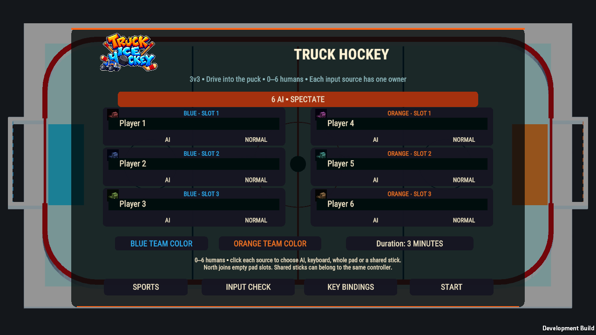
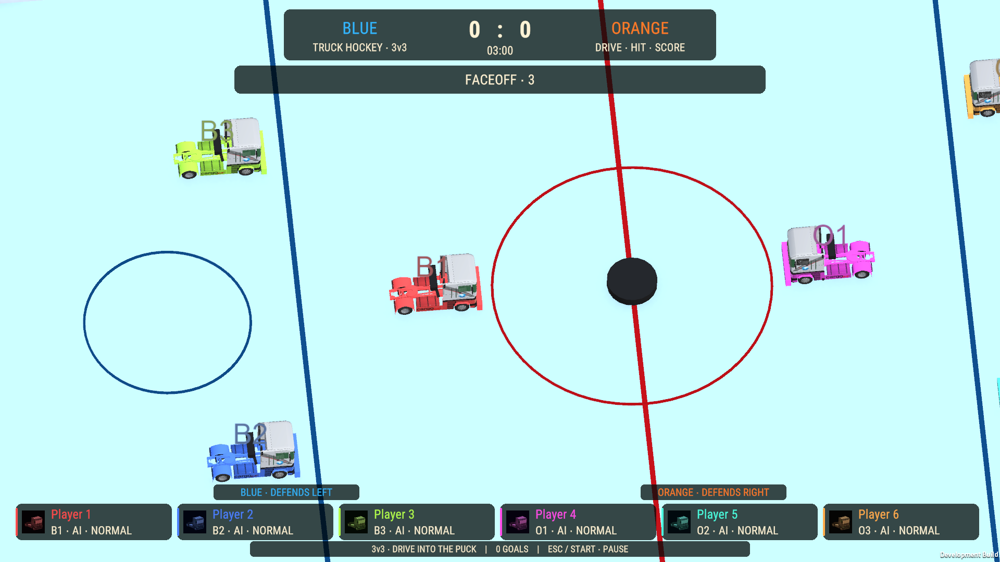
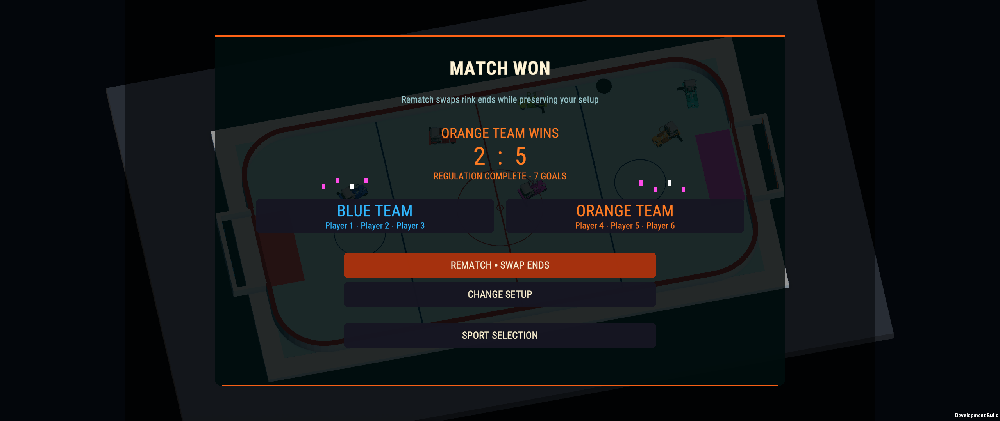
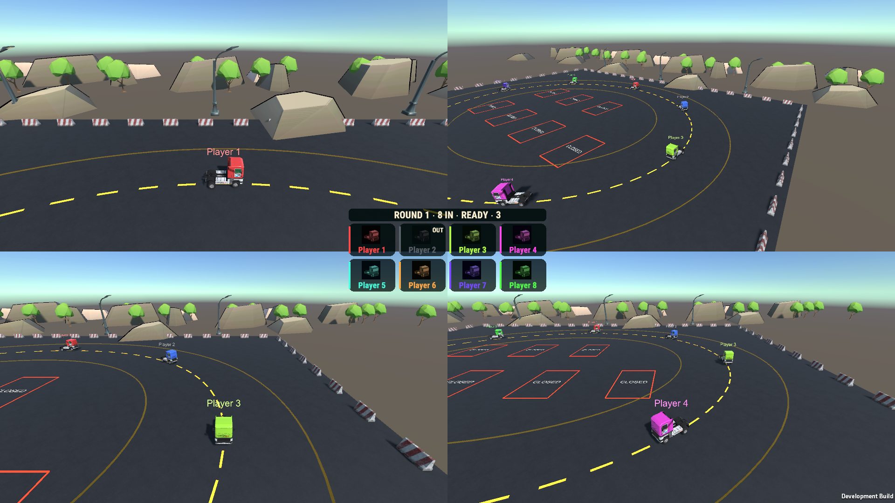

# October22 — Hockey and Musical Parking repair milestone

This is a scoped delivery within the active Human Playtest Repair pass. The entire acceptance ledger is not complete.

## Implemented

- **Hockey:** saved compact team score/clock panel,phase feedback,six truck portrait/crew-color cards in one bottom row,clear team accents,six setup cards,pause score/time and actual winner/goal/roster result panels. Heat controls and original rules/input/cameras retained. DOTween provides score/phase feedback.
- **Hockey root causes:** crew-member colors made BLUE/ORANGE labels misleading; the old SportsArenaOverlay reactivated empty docks every LateUpdate. Disable only that obsolete saved overlay; preserve all original scene objects. Small backplates keep footer/end tags readable against ice.
- **Musical Parking:** shared SportsBroadcastScores opt-in elimination layout. All8actual competitors remain visible in shared/split views. Dim gray OUT portraits preserve names; existing capture progress and red penalty locks remain. A full-screen camera gets a small bottom row; multiple views share one center group. Large top/footer/repeated view text removed. No game rules,AI or vehicle/camera behavior changed.
- **Verification tooling:** targeted native and Windows fixtures,actual-GO Snake UI wait,end-of-frame Parking inspection and explicit synthetic-device/focus isolation. These are verification-only; they do not change production focus/reconnect policy.

## Files and scenes

Hockey scene: Assets/TruckHockey/Scenes/TruckHockey.unity. HockeyMenus,HockeyPresentation,HockeyPresentationAuthoring,HockeyPresentationProbe. Shared SportsEventSession/SportsBroadcastScores; ParkingMatch/ParkingCompactHudProbe. Native HockeyPresentationTests,ParkingCompactPresentationTests,HockeyPresentationRegressionTests and corrected SnakePresentationTests. Explicit existing validation pipeline gains hockey-hud authoring; normal builds do not regenerate scenes.

Scene preservation review:3509original Hockey serialized documents retained,252new UI documents,zero removals. No physics,camera,mesh,light or environment transform changes.925unrelated pending files,including private Taxi/navigation work,preserved byte-for-byte.

## Actual validation

| Exact final Windows run | Passed | Failed |
|---|---:|---:|
| ParkingInputIsolatedWindows | 1081 | 0 |
| HockeyInputIsolatedWindows | 567 | 0 |
| HockeyInputIsolatedGoalsWindows | 39 | 0 |
| SharedCompactInputIsolatedWindows | 234 | 0 |

Total:1921assertions. Hockey completed two actual physical six-AI matches; Parking completed7rounds/28physical captures. Native latest UI3/0,preceding cross-sport4/0 and EditMode2/0. Earlier native Hockey goal coverage includes18real center/clear-frame passages. Rejected candidates and failures remain recorded; compilation alone was not acceptance.

Hockey images below are real Windows gameplay/setup/results. Parking's four-view image is an explicitly forced eliminated-state presentation fixture; the autonomous match was verified separately. It is not evidence of four physical human players.

## Delivery and limits

Windows x64 development build: **Builds/TruckSports/TruckSports.exe**,545companion files,60scenes. Managed SHA`a6785b396911e80b7ae8b141ed40c5320f7d159a98eb9818339aafeb9e5feba3`. Full payload SHA`6c5b4e088e1ea961f626fb60f6a1a5fd970b15dd9c86bc8182f8f81fa19aa0cd`. Exact163source snapshot is retained in Logs/TruckSports/PlaytestRepair/build-6c5b4e088e1ea961f626fb60f6a1a5fd970b15dd9c86bc8182f8f81fa19aa0cd-sources.zip. Portable test receipt: Evidence/2026-10-22-Hockey-Parking/acceptance.json. The reviewed scoped source commit contains this report; post-commit branch verification is retained separately in Logs/TruckSports/PlaytestRepair.

Original human Hockey missed-goal report remains unreproduced; no production goal-rule correction claimed. Parking bay artwork24-2,Fare's intermittent healthy zero-power stall and other active requirements remain open. No physical-controller,listening,human-playtest or isolated performance certification claimed. Existing help/settings behavior retained; hardware/reconnect acceptance still requires actual devices.

**TUG OF WAR:** Brainstorm additional mechanics with the developer and ChatGPT. Current gameplay is too dependent on holding reverse. No changes were authorized during this pass.

## Vendor accounting

- **VENDOR ASSETS AUDITED:** installed Heat ButtonManager/fonts,existing SportsBroadcastCanvas/Plate/Page/Scores,DOTween lifecycle/public tween APIs,Unity Input System and saved Hockey/Parking hierarchies. Existing NWH/Cinemachine vehicle/camera authority inspected and preserved.
- **VENDOR ASSETS USED:** Assets/Heat - Complete Modern UI/Scripts/UI Elements/ButtonManager.cs; existing Heat-derived TMP heading/body assets and Broadcast truck portrait; existing rounded plates,DOTween score/phase animation and native Unity input APIs. Existing NWH truck assets and shared cameras retained.
- **RELEVANT ASSETS NOT USED:** no new art generator,physics,weather,navigation or alternate UI framework required. Installed Heat/shared presentation already provides the foundation.
- **CUSTOM SYSTEMS CREATED:** small read-only Hockey view adapter,explicit additive authoring,shared elimination-layout extension and verification fixtures.
- **VENDOR SOURCE MODIFIED:** NO.
- **DUPLICATE VENDOR FUNCTIONALITY CREATED:** NO.
