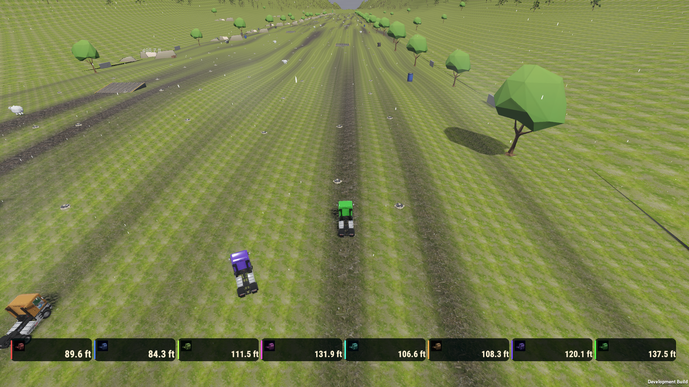
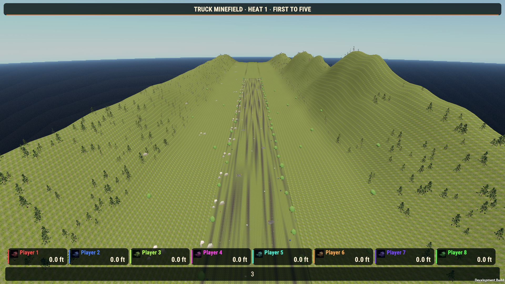

# Minefield — physical mountain ranges and continuous landing terrain

HPR-10-4 requests tall side mountains, forests and real collision while preserving the extended landing world and mine strength. The saved scene already contained a 614-metre-wide, 8.4-kilometre-long physical world, but its side terrain peaked at only 19.53 and 21.18 metres. This pass adds the missing landscape without replacing the central mine course or changing gameplay rules.

## Implementation

The explicit `MinefieldSideRangeAuthoring` tool uses the installed Vista mountain graph and `TerrainGraph.ExecuteImmediate`. Sport-owned terrain copies now reach 161.08 and 190.61 metres, with continuous outer crests and 2,500 grounded Vista pine instances on each side. Existing scenery moves only by its sampled terrain-height change, preserving its authored embedding offset. Native Terrain rendering and TerrainCollider remain responsible for the surface and forest rendering.

The first Windows candidate passed automated checks but failed visual review: it exposed an existing raised runout edge, strong grass-normal striping and sparse forest presentation. That candidate was rejected. The old runout met its neighboring meadow with a 14.019-metre vertical step. A separate owned runout asset now blends only the outer 17 metres on each side to the neighboring terrain. Its central 80-metre corridor remains unchanged. The measured edge mismatch is now 0.000458 metres. Owned grass/rock layer variants reduce excessive normal strength; the original vendor layers remain untouched.

Saved assets live under `Assets/TruckMinefield/Materials/`:

- `West meadow and Vista mountains.asset`
- `East meadow and Vista mountains.asset`
- `Seamless mountain landing runout.asset`
- `Range meadow grass.terrainlayer`
- `Range exposed rock.terrainlayer`

The sport-owned tree variant is `Assets/TruckMinefield/Prefabs/Outer mountain pine.prefab`. Decorative forest instances introduce no additional physical tree blockers. Mountain terrain itself has matching physical collision. Normal builds, entering Play Mode and rematches do not regenerate these assets. Repeating the explicit upgrade preserved all saved Minefield scene, terrain, prefab and layer bytes.

## Preservation and validation

All 16,700 original scene documents remain. The scene review permits only terrain/collider data references, terrain view settings and height-only changes to existing tree/rock roots. The mine course, trucks, forces, controls, cameras, rules and UI remain unchanged. Original terrain and vendor assets are retained. All 925 unrelated pending files pass the SHA-256 preservation guard.

Final native EditMode: **4 passed, 0 failed**, including side ranges, continuous runout seams, Vista render-resource cleanup and existing distance progression. Final native PlayMode: **1 passed, 0 failed**, exercising real NWH/PhysX landings on both mountains, once-only rest scoring and rematch. The controlled launch fixture initializes position and velocity; it does not inject score results. An earlier unconstrained violent crest launch genuinely left the map; its failure is retained and no mine-force reduction was used to force it inside.

Exact final Windows candidate `f4a39ad0` passed **89 Minefield checks**: landscape/ordinary round 14/0, complete eight-AI match 23/0, final-rest regression 52/0. The complete match ran thirteen heats with 143 physical blasts, 100 rest locks, one genuine escape and zero supported timer locks. Its winner finished with five heat points. The first complete-match probe failed because it counted a true escape as a supported timer lock; the corrected probe separately verifies the actual last valid grounded score. No production physics or scoring change was needed.

Actual 720p/1080p Windows images were inspected. Landscape fixtures show the stitched terrain and native forests; sample-texture repetition is still visible in wide views and is recorded as an art-direction limitation. Portable evidence is in `Evidence/2026-10-22-Minefield-Ranges/acceptance.json`.

 The rejected candidate and failed intermediate tests remain in local evidence history. Human playtesting, physical controllers and listening checks have not been performed during this pass.

## Vendor accounting

- **VENDOR ASSETS AUDITED:** installed Vista TerrainGraph execution, DataPool/GraphRenderTexture ownership, sample mountain graph and pine prefab; existing NWH and Minefield terrain/scoring integration.
- **VENDOR ASSETS USED:** `Assets/PinwheelStudio/Vista/Personal/Samples/Scenes/Demo_MultiLayerBiomeBlending Biomes/Mountain_TerrainGraph.asset`, Vista sample pine and terrain layers through owned variants, Unity Terrain/TerrainCollider/tree rendering, existing NWH truck physics.
- **RELEVANT ASSETS NOT USED:** EasyRoads and Spline Spawner are not needed for this existing continuous distance-course terrain. No new road network or roadside distribution framework is introduced.
- **CUSTOM SYSTEMS CREATED:** explicit saved-asset authoring adapter, terrain seam blending and focused verification probes/tests. No replacement terrain generator, vehicle physics or rendering framework.
- **VENDOR SOURCE MODIFIED:** NO.
- **DUPLICATE VENDOR FUNCTIONALITY CREATED:** NO.

**TUG OF WAR: Brainstorm additional mechanics with the developer and ChatGPT. Current gameplay is too dependent on holding reverse. No changes were authorized during this pass.**

## Build delivery

The combined Windows x64 build is `Builds/TruckSports/TruckSports.exe` with all 60 configured scenes. Full 545-file SHA-256: `f4a39ad0f4313e1e8525feebd65d321c0f857bcfc61009af3c8b0c69de18888a`. Managed assembly SHA-256: `b412868cde9ba201fb38727e1497914b4925f08b46016a94533a7f1d08463a37`. The exact 184 owned source inputs and prior accepted build are retained. Combined Minefield/Billiards Windows acceptance is 107 checks with zero failures. This is a scoped milestone; other active HPR/GBC requirements remain unfinished.
