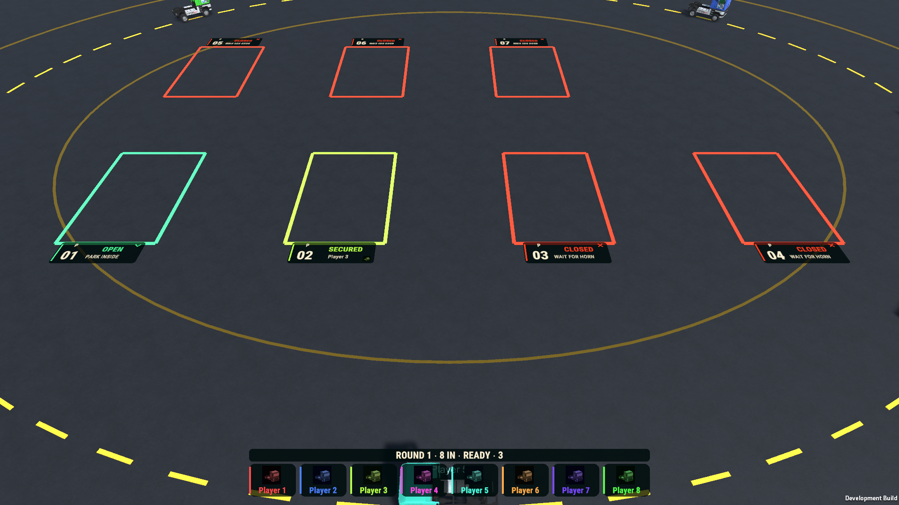
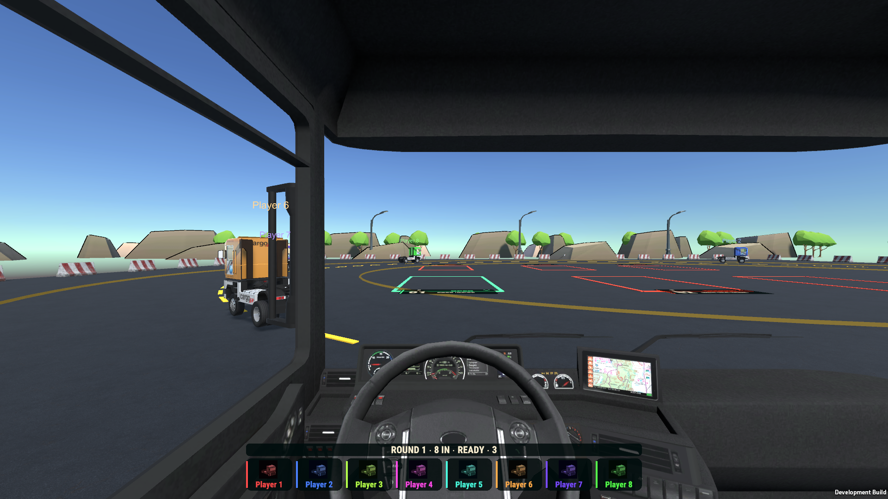

# Musical Parking — numbered bay presentation

Implemented HPR-24-2 in the existing saved scene. Eight bays have numbered rounded ground plates,open/closed/secured symbols,actual owner portrait/name/color,thicker original paint outlines and a sport-owned reflective paint material. One shared world canvas and small DOTween state animation reuse the existing Heat/TMP presentation. ParkingBay retains all gameplay authority.

The first native image revealed missing digits. Their text existed,but TMP's minimum65point font could not fit the70pixel-high box and truncated it. A regression test failed before correction. Explicit known-stock fitting now uses60points in78pixels;actual rendered Windows digits are visible. Customized authored settings are preserved by the explicit migration; entering Play Mode or normal builds never regenerate the artwork.

Changed files: ParkingBayAppearance.cs,ParkingBayAppearanceAuthoring.cs,ParkingCompactHudProbe.cs,ParkingBayAppearanceTests.cs,TruckMusicalParking.unity,Reflective bay paint.mat and the existing scoped validation/export tools. All4343original scene documents survive;403presentation documents added. Original physics,capture footprints,cameras,rules and AI remain unchanged.925unrelated pending files are SHA256-identical.

## Actual verification

- Unity6000.4.10f1 compilation/build succeeded. Targeted final PlayMode tests:4passed/0failed. Explicit authoring rerun preserved the saved-scene hash.
- Windows ParkingBayAppearanceWindows:1093passed/0failed,61.75real seconds. Twenty software-device/AI-camera configurations at720p/1080p;three actual bay presentation states;owned cab-camera fixture;complete eight-AI physical match with7rounds/28captures;rematch and menu cleanup.
- Images below are actual Windows captures. State and cab positions are explicit presentation fixtures. Physical match acceptance is separate;this is not four-human or physical-controller testing.
- Full payload `541e5c98d472bb9f3ce8a2a264d6900a777cf681123eae4e2c5e6ef33ad0bd33`,managed `241ba26a1356c4a24b26e7d250127372a6162c52ce26fccc33e80d6b149b4c4f`. Portable receipt:Evidence/2026-10-22-Parking-Bays/acceptance.json. Previous accepted build is retained under .sports-validation/Recovery.

## Delivery and limits

Windows x64 development build:**Builds/TruckSports/TruckSports.exe**,545companion files,60scenes. No physical-device,human-playtest,listening or isolated performance certification claimed. Other active HPR/GBC requirements remain open;this is not whole-backlog completion. Fare intermittent immobility and the human Hockey missed-goal report remain unreproduced;no speculative production fixes claimed.

**TUG OF WAR: Brainstorm additional mechanics with the developer and ChatGPT. Current gameplay is too dependent on holding reverse. No changes were authorized during this pass.**

## Vendor accounting

- **VENDOR ASSETS AUDITED:** existing Heat/TMP/shared portrait/rounded plates,DOTween,original Parking paint,installed JC city subset and RoadPropsPack signage.
- **VENDOR ASSETS USED:** Heat-derived fonts,existing truck portrait,SportsBroadcastPlate and DOTween. Existing paint geometry and cloned stock material reused. NWH/Cinemachine authorities preserved.
- **RELEVANT ASSETS NOT USED:** vertical RoadProps signs would add obstruction around the capture area;existing noncolliding floor presentation is sufficient. No alternate UI/physics/navigation framework required.
- **CUSTOM SYSTEMS CREATED:** read-only bay-state view adapter,explicit additive authoring and focused tests.
- **VENDOR SOURCE MODIFIED:** NO.
- **DUPLICATE VENDOR FUNCTIONALITY CREATED:** NO.
